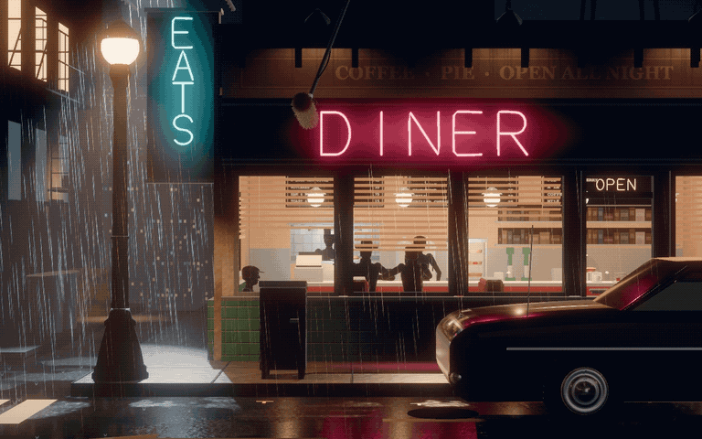

# Window

A browser app that turns a laptop screen into a window. The webcam follows
your open eye, and every frame is drawn from exactly where that eye is, so the
scene behind the screen holds still in space while your head moves. Lean to
look around things; duck to see what is above. To move around inside a scene,
carry the window with the arrow keys, a drag or a two-finger swipe, or let the
tour (T) take you through it.



*Recorded in mouse mode, where the pointer stands in for your head; sped up and trimmed.*

## Running it

You need a Mac with a webcam, Chrome, and Node.js 20.19 or newer (22.12 or
newer on the 22 line).

```
npm install
npm run dev
```

Open the localhost address it prints (http://localhost:5190/) in Chrome. Then:

1. Go full screen (the button on the first card, or F), so the scene lines up
   with the physical display.
2. Choose the eye you will keep open, then choose Use camera and allow the
   camera when Chrome asks.
3. Keep both eyes open for two seconds while it measures the spacing of your
   eyes (first visit only).
4. Close the other eye, sit about an arm's length away, and lean.

By default the view turns the way you lean (Look around), three times as far
as your head moves (a 15 cm lean swings the view 45 cm; rising and ducking
four and a half times), and it follows through a soft spring that ignores
the small sway of a seated head. Turning your head steers it too: tilt your
head back to see more of the top, turn it to see more of a side. Press V
for the true window, where the scene stays put behind the glass, and R to
re-centre on where you sit.

Use mouse instead skips the camera: the view then follows the pointer.

For the best match on your machine, run the steady check (C) once. It walks
through seven short steps that use your eye's reflection in the dark screen
to set eye spacing, camera height and the camera's field of view.

`npm run build` writes a static build to `dist/`; `npm test` runs the unit tests.

## Controls

| Key | What it does |
| --- | --- |
| 1, 2 | Soundstage, Box |
| [ and ] | Previous and next scene |
| ↑ and ↓ | Move forward and back |
| ← and → | Step left and right |
| Shift + ↑ and ↓ | Rise and sink |
| Shift + ← and → | Turn left and right |
| + and - | Shrink into the set, grow back |
| N, Shift + N | Next place, the place before |
| T | Guided tour, start and stop |
| H or Home | Back to the first place |
| F | Full screen on and off |
| V | View direction: Look around or True window |
| R | Re-centre the view on where you sit now |
| C | Steady check |
| D | Tracking details (and Record tracking log) |
| S | Settings |
| Esc | Close the open panel, or stop the tour |

| Trackpad or mouse | What it does |
| --- | --- |
| Drag | Turn and tilt; the scene follows the pointer |
| Two-finger swipe, scroll wheel | Up and down move forward and back; sideways turns |
| Pinch | Move forward and back |

### Moving around

Each scene has named places to visit. Their names sit in a small strip above
the controls at the bottom; click one, or press N, and the window glides there,
slowing out and in, turning the short way round. The name shows at the top of
the screen when you arrive. T starts a tour that glides through the places,
stops at each for four seconds and goes round until you press T or Esc, or
move. Your head still works the whole time: lean and turn to look around
wherever the window is.

Moving keeps to the parts of the set that are built. + takes you smaller,
into the set (everything looks bigger), down to about a twentieth of your
size (life size and a little smaller in the Soundstage's 1:16 set, about a
seventeenth in the Box); - grows you back. Speeds are the same at every size, and a held arrow key
speeds up after a moment. All motion goes through the same kind of soft,
critically damped spring as head tracking, so it never swings past where it
was sent.

Some places hold head tracking in. Far away through a small window, moving
your head mostly pans the picture, like a long lens, so at those places Look
around moves the view less for each centimetre you move (at most the place's
own strength, with no extra up and down). Those places also stop the view
backing too far from the glass, in every view direction and in phone lens
mode, so leaning back there does not put the view inside a wall behind you;
True window and phone lens mode otherwise stay exact. In the Soundstage your
eye also stays inside the stage building wherever you move. Gliding to or
from such a place eases between the two.

Moving does not wake the controls: the arrow keys, + and -, scrolling,
pinching and dragging the scene leave them faded while you look around.
Moving the pointer brings them back.

With Use mouse instead, moving the pointer stands in for leaning your head,
so to turn, hold the button down and drag: the lean holds still until you
let go.

A two-finger swipe and a mouse wheel arrive in the browser as the same
event, so both mean the same: up and down move you, sideways turns. With
macOS's natural scrolling (the default), fingers or wheel away from you move
you forward. A pinch never zooms the page, which would put the scene out of
line with the display.

Settings, Motion:

- **View direction.** Look around (the default) mirrors your head's movement
  about where you sit: lean right to see more of the right side, lean in and
  the scene grows, rise and you look down into it. True window is the
  physically exact window: the scene holds still behind the glass and
  leaning right shows more of its left side.
- **Strength**, 1x to 5x: how far the view moves for each centimetre you
  move (depth gets half the extra). 1x is exact. Kept per direction: 3x for
  Look around, 1x for True window. In Look around, rising and ducking get
  1.5 times as much (4.5x at the default), since a seated head moves up and
  down far less than sideways.
- **Head turn steers the view** (on), Look around only: where your face
  points moves the view as well as where your head is. Tilt your head back
  to see more of the top, look down for more of the bottom, turn right or
  left for more of that side: the same ways as rising, ducking and leaning.
  Turns of a few degrees are ignored (the small turns a head makes all the
  time), and a turn you hold stays put, like a held lean. Looking further
  down, at the keyboard (from about 20 degrees), fades it out, so the view
  comes back to where it was until you look up again.
- **Turn strength**, 0.25x to 2x: how far a turn moves the view. At 1x a
  15 degree tilt moves it about 20 cm, and no turn moves it more than about
  25 cm up or down or 30 cm sideways.
- **Re-centre** (R): where you sit now, and the way your face points, become
  the centre. By itself the centre only follows small shifts (within a
  centimetre or two degrees); a lean or a turn stays put for as long as you
  hold it. After 25 seconds still in a new place it starts to follow,
  slowly, so after moving your chair press R.
- **Smoothness**, responsive to calm: how softly the view follows. The
  middle is the default.
- **Predict ahead** (off): the earlier tuning, which extrapolates to hide
  camera delay. Quicker, but it can swing past where you stop; it brings
  back the Steadiness and Look-ahead sliders.

The steady check and phone lens mode always use the true window at 1x.

Settings also hold the display and camera choices, a camera delay check, a
screen-size measurement with a bank card for displays without a preset, and a
phone lens mode for filming the screen with a phone held beside your eye.

## Privacy

The camera picture is processed on this computer and never leaves it. Nothing
is uploaded, and nothing is recorded unless you ask for a tracking log.

- Frames go from the camera to a worker in the same tab, where MediaPipe finds
  the face's landmarks on the CPU. Only those numbers come back to the page.
- The face model (`public/models/`) and the WebAssembly runtime are served by
  the local server, not fetched from a CDN.
- The network is blocked for everything else. MediaPipe's web library sends
  usage statistics (task type, operating system, timings) to Google once a
  minute and has no option to turn that off. Before MediaPipe loads, the app
  wraps `fetch`, `XMLHttpRequest` and `navigator.sendBeacon`, in the page and
  in the worker, so that only the page's own server can be reached; anything
  else is refused, including an address it cannot read
  (`src/tracking/net-guard.js`). A Content-Security-Policy with
  `connect-src 'self'` in `index.html` is a second layer for the page.
  `tools/core-offline.mjs` checks this: it tracks a face for 80 seconds with
  every outside host routed to a local listener, and fails on any request
  that leaves the local server.
- The camera turns off while the tab is hidden.
- Settings (eye spacing, display, camera delay) are kept in the browser's
  local storage.
- Record tracking log, in the details panel (D), saves 20 seconds of numbers
  to your Downloads folder as a JSON file, through the browser's normal
  download: timestamps, camera frame rate, the eye positions the tracker
  solved and the ones it drew, whether a face was seen, and the settings in
  use. No pictures and no face mesh. It goes nowhere unless you send it; it
  is for tuning the motion to a real head (`node tools/core-motion.mjs
  --replay file.json`).

## Hardware it was tuned on

- MacBook Air 15-inch (M2), whose display and notch position are measured
  into the default display preset. Presets for the 13-inch Air and the 14- and
  16-inch MacBook Pro are included; other screens can be measured with a card.
- The built-in FaceTime HD camera, used at 1280 x 720 and 30 frames a second.
- Chrome on macOS, at 60 frames a second. The app lowers its own resolution if
  frames or tracking start to fall behind.

## How it works

A picture looks the same from wherever you stand. A window does not: as you
move, near things slide across far things, and you see around edges. To fake
a window, the image has to be drawn again for every new eye position.

Head tracking. MediaPipe's face landmarker finds 478 points on the face,
including the irises, about 30 times a second. From the size and spacing of
the eyes in the picture, the camera's field of view and the camera's known
place in the notch, the app works out where the open eye is in three
dimensions, in metres from the centre of the screen.

Smooth motion. A seated head is never still: it sways a few millimetres and
makes small corrections, and a webcam in a dim room adds noise and drops to
15 frames a second. The view therefore does not chase every sample. A small
dead-band (6 mm) lets the sway pass, the samples are lined up by when the
light hit the sensor and drawn a fixed delay behind, so the 15 or 30 updates
a second become one continuous movement, and a critically damped spring
follows that. The spring cannot overshoot, so the view never swings past
where your head stopped. It costs about a quarter of a second of lag on a
quick lean. (Predicting ahead hides more of the delay, but on a real head it
swung past every stop.)

Off-axis projection. The screen is treated as a fixed rectangle in space and
the eye as a point. The view is the pyramid from the eye through the screen's
four corners, which is lopsided whenever the eye is not straight in front of
the centre. This is the generalized perspective projection described by
Robert Kooima ([Generalized Perspective Projection, 2008](https://web.archive.org/web/20161115172606/http://csc.lsu.edu/~kooima/pdfs/gen-perspective.pdf));
`src/core/projection.js` is its case for a screen facing the viewer. The
scenes are built in real metres, mostly behind the glass and a little in
front of it.

Why one eye. With both eyes open, stereo vision reports that the picture is
flat on the glass, and that fights the motion parallax. With one eye closed,
parallax is the main depth cue left, and it reads as depth. A camera has one
lens, so it sees the effect too, which is what the phone lens mode is for.

More detail: `docs/ARCHITECTURE.md` (coordinates, the per-frame flow, the
scene contract), `docs/CORE_NOTES.md` (tracking and measurements),
`docs/SCENES_NOTES.md` (scenes) and `docs/REFERENCES.md` (sources).

## Scenes

- **Soundstage.** A 1:16 miniature film set: a night-rain shot of a corner
  diner, with a parked car close behind the glass and a boom mic just in front
  of it. Lean and the window shows the set around the shot: lights on stands,
  flags, a camera on a dolly, the braced backs of the flats, the rain rig
  overhead. Swing wide and it shows the rest of the stage: to one side video
  village (the monitors carry the shot), the director's and cast chairs,
  craft services, flats in storage and the stage door under its exit sign and
  red rolling light; to the other the street running on under the end of the
  rain rig to a painted translight of the city, which gives itself away from
  the side, and the water truck's hose; above, the grid, catwalks, chain
  motors and the roof trusses; below, the dolly track, cables and spike tape.
  Its places, at life size apart from the shot: on the sidewalk at the
  diner's window; inside the diner, down its whole length from the far end
  (the end wall is a wild wall and flies out); behind the A-camera on its
  dolly, its monitor showing the shot live; the painted backdrop where the
  street runs into it; backstage in the gap behind the diner, down to the
  stage door; video village, its monitors live; up on the catwalk.
- **Box.** A room exactly the size of the window and 50 cm deep, lit by a low
  sun through a paper lattice, with a dusk view through a round window at the
  back and a small bell hanging in front of the glass. Swing wide and the
  shoji beside the lattice stands slid open onto an engawa and a small garden
  at dusk: moss and stepping stones, a stone lantern with its candle lit, a
  maple in red, a garden wall and two ridges under the evening sky. The room
  is one room of a whole house: plaster and cedar walls, a gabled tile roof,
  eave rafters with a wind bell, a crawl space on stone footings; beside it a
  next room with a tokonoma, a hanging scroll, a chest and a brazier; outside,
  the garden on a stone terrace (a stone basin with a bamboo spout, raked
  gravel, azaleas, a hedge and a bamboo grove) above a valley of forest and
  layered ridges under a dusk sky. Its places: the room at rest; the next
  room, from its corner to the tokonoma; by the round window; out on the
  engawa; under the eave, looking up at the wind bell against the dusk; and
  the garden, from beyond the maple looking back at the house.

All geometry and textures in both scenes are made in code; there are no
third-party assets.

## Credits

- MediaPipe face landmarker model and `@mediapipe/tasks-vision` by Google,
  Apache License 2.0. The model is included unmodified in `public/models/`,
  with the full licence text beside it.
- [three.js](https://threejs.org/) (MIT) for rendering, [Vite](https://vite.dev/)
  (MIT) for the dev server and build, [Playwright](https://playwright.dev/)
  (Apache-2.0) for the headless test tools.
- The tests use MediaPipe's canonical face mesh (Apache-2.0, `tests/fixtures/`).
- Johnny Lee's 2007 Wii Remote head-tracking demo, which made this idea
  widely known.

## Known limits

- Tracking has been tuned on synthetic webcam clips and simulated heads in
  headless Chrome, and tried once on a real face (FaceTime camera, dim room).
  A tracking log from a real head is the next tuning step. Real faces,
  lighting and glasses may also need the steady check and the camera delay
  check to look their best.
- One viewer, one open eye. With both eyes open the scene looks flatter.
- Built and tested for Chrome on a Mac. Other browsers are untested.
- The display presets other than the 15-inch MacBook Air come from Apple's
  published specifications; their notch and camera positions are estimates
  (the steady check corrects the camera height).
- The view trails a lean: it reaches 90 % of a quick 15 cm lean about
  0.25 s after your head does (0.3 s when the camera runs at 15 frames a
  second). Smoothness toward Responsive shortens that a little. A head turn
  is followed more slowly (its pose is noisier and is smoothed more): half
  way about 0.3 s after your head, 90 % after about 0.5 s.
- Look around and Strength above 1x are not physically exact; for filming
  with a phone, and for the steady check, the app uses the true window. The
  view stays within a cone in front of the screen (45 degrees sideways, 39
  up or down) that both scenes are built out to fill.
- Head turn reads where your face points from the face tracker's head pose.
  It is tuned in simulation, with that pose's jitter assumed at 0.5 to 1
  degree a frame; a real face may need a different Turn strength.
- With Look around, after you move your chair or sit back the view stays
  off-centre until you press R, or for a minute or so while the centre
  slowly follows.
- Full screen is the intended mode. In a window, the app assumes any side
  panel is on the right.
- Switching scenes takes two to three seconds, through black. A new scene
  starts at its first place.
- Moving around has no collisions: inside the allowed space the window can
  pass through things. In the Soundstage your eye is kept inside the stage
  building, so leaning never takes the view through its outer walls; the Box
  has no such limit when you move away from its places. On a Mac laptop the
  Home key is fn + left arrow (H
  does the same). The trackpad and drag speeds are set by hand, not yet
  tried on a real trackpad.
- A fanless laptop can get warm in long sessions; the app steps its
  resolution down rather than drop frames.

## Licence

Licence: not yet chosen. The vendored MediaPipe model keeps its own Apache 2.0
licence (`public/models/`).
